# Picord 多人使用说明手册（图文完整版）

> 适用版本：支持**默认私有隔离与共享群组**的 Picord（线上入口示例：`https://bot.851127.xyz`）  
> 核心原则一句话：**每人建的对话和 `#频道` 默认只有自己能看；只有创建者主动分享拉人后，才变成大家共同可见的共享群组。**

---

## 目录

1. [第 1 步：登录账号或用邀请码注册](#第-1-步登录账号或用邀请码注册)
2. [第 2 步：进入个人独立工作台（默认私有隔离）](#第-2-步进入个人独立工作台默认私有隔离)
3. [第 3 步：新建私人对话与私有 `#频道`](#第-3-步新建私人对话与私有-频道)
4. [第 4 步：把对话或 `#频道` 分享成共享群组](#第-4-步把对话或-频道-分享成共享群组)
5. [第 5 步：被邀请人视角与群内协作规则](#第-5-步被邀请人视角与群内协作规则)
6. [第 6 步：成员主动退出共享群组](#第-6-步成员主动退出共享群组)
7. [附录：中英文切换、常用快捷操作与手机端安装](#附录中英文切换常用快捷操作与手机端安装)

---

## 第 1 步：登录账号或用邀请码注册

### 1.1 已有账号登录

1. 用浏览器打开站点地址（例如 `https://bot.851127.xyz`），未登录时会自动跳转到登录页 `/login`。
2. 在 **Username** 输入你的用户名，在 **Password** 输入密码。
3. 点击 **Sign In** 即可进入你的个人工作台。
   - 如果管理员为你生成了应急登录链接，也可以点击底部的 **Token sign-in** 粘贴一次性登录口令进入。

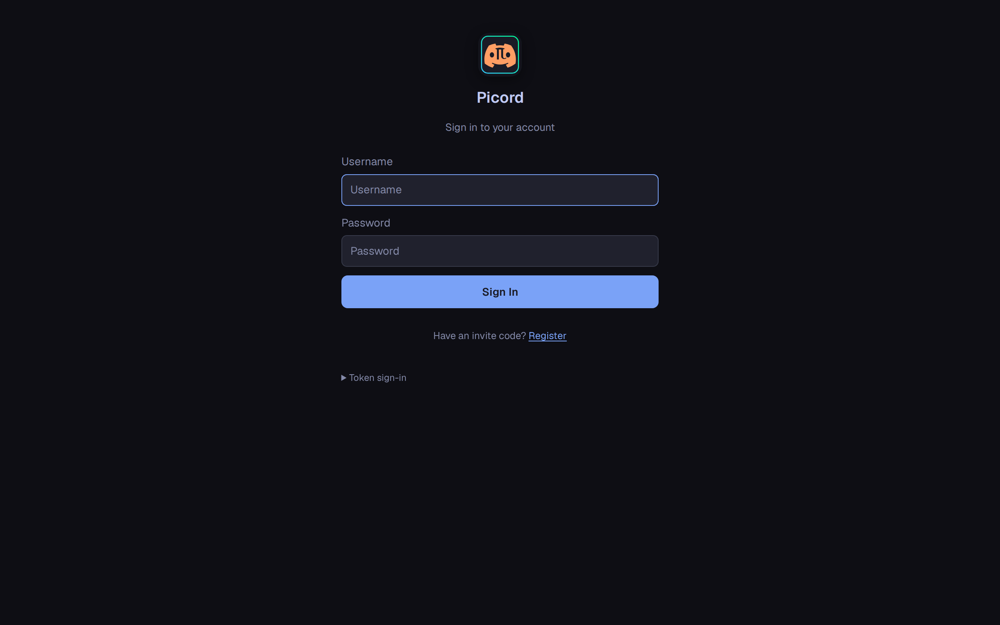

### 1.2 新成员使用邀请码注册

如果你还没有账号，需要先向管理员（或给你发单会话邀请的人）拿到**邀请码 / 邀请链接**：

1. 直接点击对方发给你的邀请链接，或在登录页点击 **Register** 进入注册页 `/register`。
2. 依次填写：
   - **Invite Code**：填入收到的邀请码（通过邀请链接点进来时通常会自动带入）。
   - **Username**：设置你的用户名。
   - **Password** 和 **Confirm Password**：设置并确认登录密码（至少 6 位）。
3. 点击 **Create Account** 完成注册，系统会自动登录并进入工作台。

> **小提示**：如果是**单会话邀请链接**，新账号注册成功后只能看到被邀请加入的那 1 个共享对话，且不能自己新建其他对话；如果是**普通邀请码**，则拥有完整的个人工作台权限。

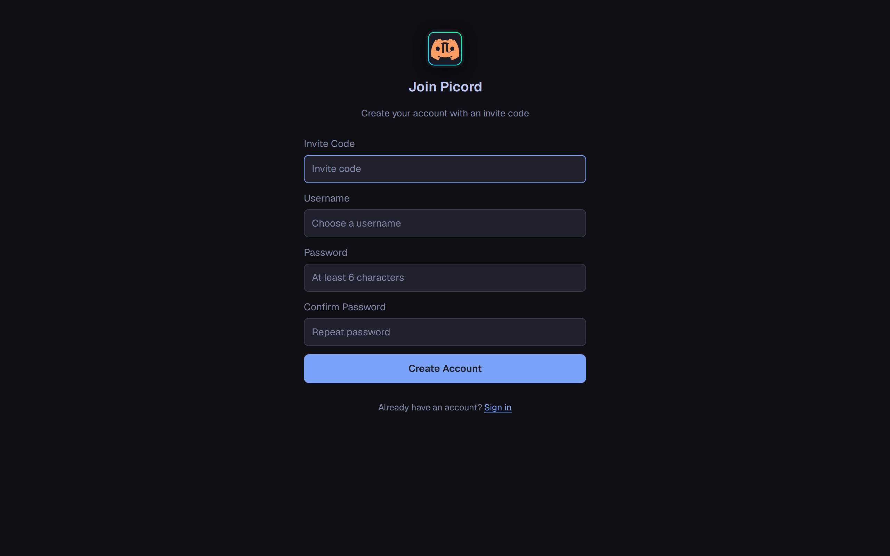

---

## 第 2 步：进入个人独立工作台（默认私有隔离）

登录后，每个人的空间都是完全独立的：

- **只看自己的与已加入的群**：不管你是普通成员还是管理员（`owner`），默认都只能看到**自己创建的对话**和**别人拉你进去的共享群组**。
- **别人看不到你的隐私**：你在自己工作台里的历史聊天、草稿、私有 `#频道`，其他任何账号都看不到，也不能搜到。

下面是同一个服务器下、同一时间两个账号看到的对比：

- **管理员 `John` 登录后**：只显示 `John` 自己的 5 个会话（`#smalltalk`、`#zk-review`、`#general`、`#report`、`你好`）。

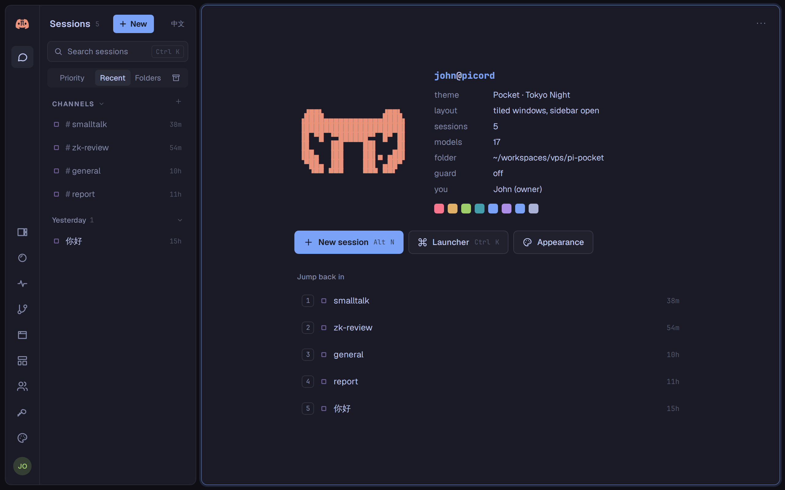

- **新账号 `tester` 登录后**：界面显示 `Sessions 0`（`No sessions yet. Start one with New.`），`John` 的任何历史会话和频道都不会泄露给 `tester`。

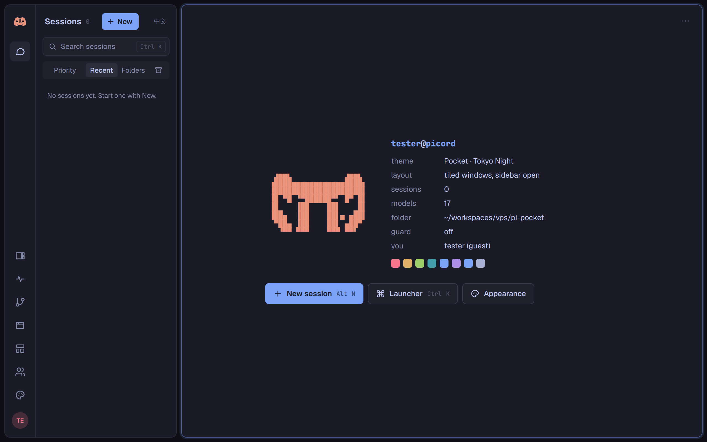

---

## 第 3 步：新建私人对话与私有 `#频道`

### 3.1 新建普通私人对话

1. 点击左上角侧栏的 **+ New** 按钮，或点击欢迎页上的 **New session**（快捷键 `Alt + N`）。
2. 在弹出的 **`New session: pick a folder`** 窗口中，选择 Pi 要工作的文件目录（默认选中默认工作区）。
   - 如果想让这个对话拥有独立的 Git 代码分支互不干扰，可以勾选左下角的 **Own git worktree**。
3. 点击右下角 **Open**，立刻创建一个属于你自己的私人对话。
4. 在底部输入框输入问题发送给 Pi；也可以使用 **Voice**（按住说话语音转文字）、曲别针按钮上传文件/图片，或切换底部显示的 AI 模型与思考深度。

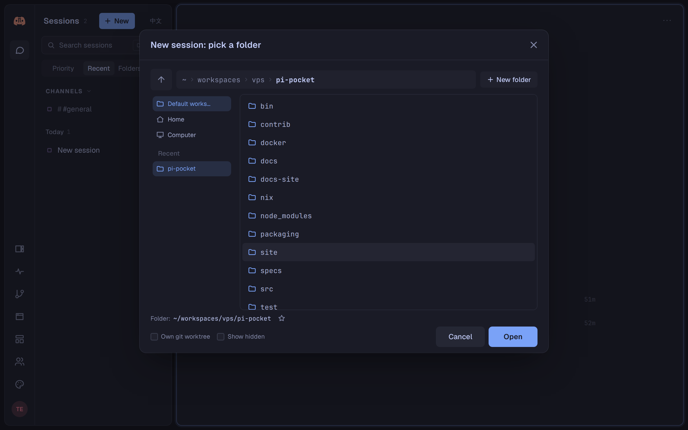

### 3.2 新建私有 `#频道`

`#频道` 适合长期固定的主题或项目，它会固定显示在侧栏顶部的 **`CHANNELS`** 分组里：

- **创建方式**：
  - 方式一：点击左侧栏 **`CHANNELS`** 标题右侧的 **`+`** 按钮，输入频道名称后确认。
  - 方式二：在任意对话底部输入框输入 `/channel general` 并发送（推荐直接写不带 `#` 的英文名，如 `general`）。
- **私有与重名规则**：
  - 新建出来的 `#频道` **一开始是私有的**，只有你本人能看见。
  - 你可以和别人起**一模一样的名字**：比如 `John` 自己建了 `#general`，`tester` 也能自己再建一个 `#general`，两者互相完全隔离、互不冲突。
  - 只有你自己名下**尚未共享**的私有频道才不允许重复创建两个同名的（若再输入同名会自动帮你打开已有的那个）。

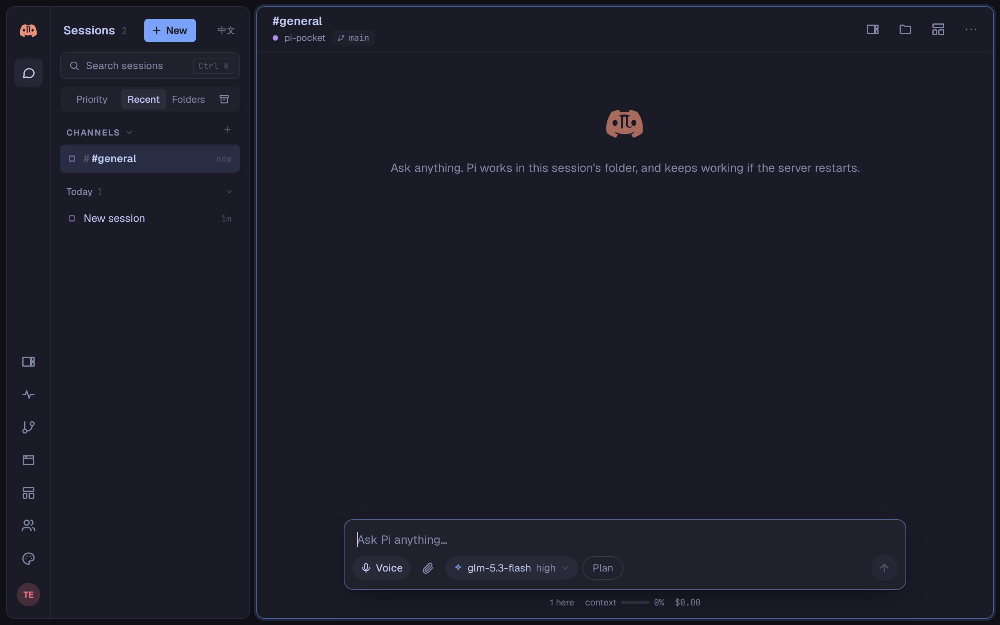

---

## 第 4 步：把对话或 `#频道` 分享成共享群组

当你想让其他人一起看某个对话或协作讨论某个 `#频道` 时，可以把它升级成**共享群组**（只有对话/频道的**创建者**能管理成员）：

1. 进入你想分享的私人对话或 `#频道`。
2. 点击聊天区顶部的**标题栏**（如 `general · pi-pocket`）或右上角菜单，打开会话菜单。
3. 在菜单中找到并点击 **Share（add people or invite）**，打开分享面板。

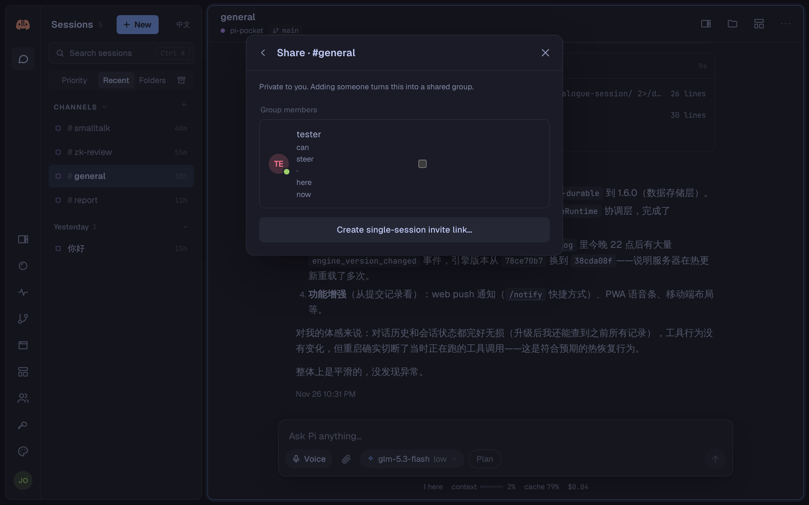

4. 在 **`Share · #频道名`** 面板中，有两种拉人方式：
   - **拉入已有注册用户（推荐）**：在 **Group members** 列表中直接勾选同事账号（例如勾选 `tester`）。勾选后立刻生效，该会话随即升级为 **Shared group**（上方会提示当前群人数）。
   - **邀请尚未注册的新人**：点击底部的 **Create single-session invite link...**，复制生成的单会话专属邀请链接发给对方；对方注册后会自动加入这个群组。
5. **随时移出成员**：创建者再次打开 `Share` 面板取消勾选某位成员，该成员会立刻被移出群组并失去查看/操作权限（即使他当时正打开着这个页面也会被即时清退）。

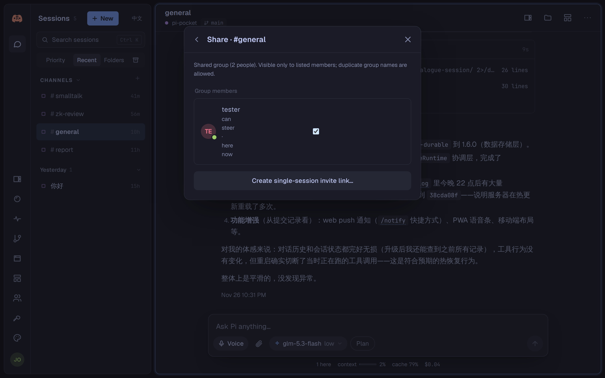

---

## 第 5 步：被邀请人视角与群内协作规则

### 5.1 自动出现且用 `· 创建者` 区分重名

当你被拉进别人的群组后，左侧栏会立刻同步显示这个对话或频道：

- 他人分享给你的会话，标题后会自动带上 **`· 创建者名字`** 标记与创建者头像徽章（例如 `John` 分享的频道会显示为 **`#general · John`**）。
- 就算你自己名下本来也有一个私有的 `#general`，两者也会**同时共存**、互不覆盖——你看名字后面有没有 `· 创建者` 就能一眼分清哪个是自己的、哪个是别人拉你的群。

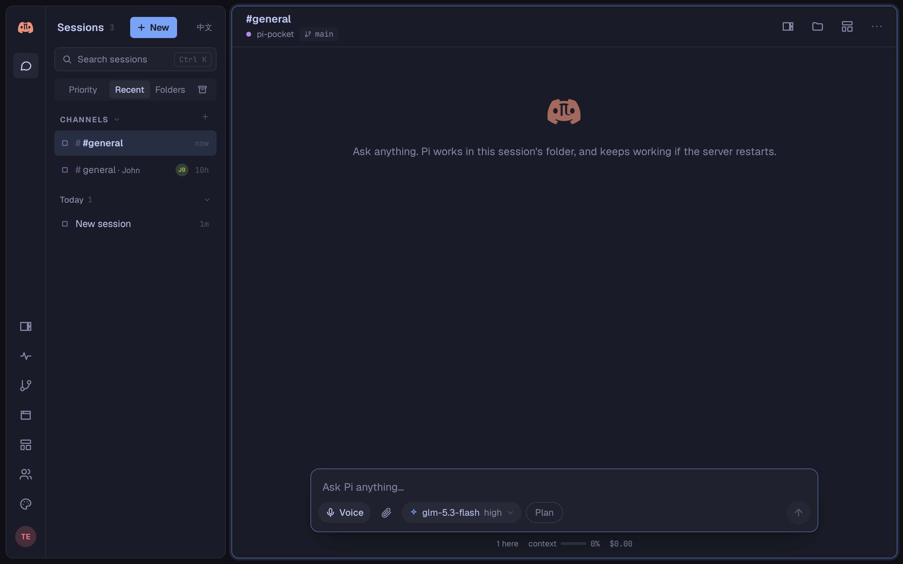

点开 `#general · John` 后，顶部标题栏、右上角成员头像以及完整群聊记录都会同步展示出来，群成员可以直接在群里继续发消息或查看结果：

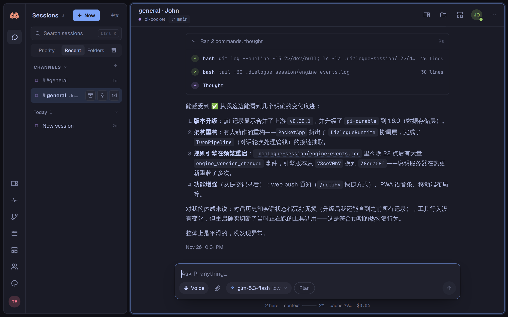

### 5.2 共享群组内的协作与安全保护

1. **防止 AI 泄漏成员私人记录**：在共享群组里向 Pi 提问或让 Pi 搜索历史记录时，系统会自动限制范围——群里的 AI **只能搜索当前群聊本身，以及所有群成员共同都有权限查看的其它对话**，绝不会把某位成员私人的其他对话搜出来漏给群友。
2. **同名群组投递防错**：如果你同时加入了多个叫 `#general` 的共享群组，在需要跨频道投递任务时，系统会要求用具体的数字会话编号（如 `#45`）来指定目标，避免投错群。
3. **防止多人同时操作打架（轮流模式）**：多人都在同一个群里发消息时，可以由群成员在菜单里配合使用 **Take turns**（同一时间由一个人驱动 Pi）或正常排队发送，各自发出的消息都会带有发送者头像与名字。

---

## 第 6 步：成员主动退出共享群组

如果被拉入的群聊你不再需要关注，可以随时自己退出（创建者本人不能退群，如需取消共享可在 `Share` 中取消所有成员勾选）：

1. 进入你要退出的共享群组，点击顶部标题栏打开会话菜单。
2. 在菜单中点击 **Leave group**。

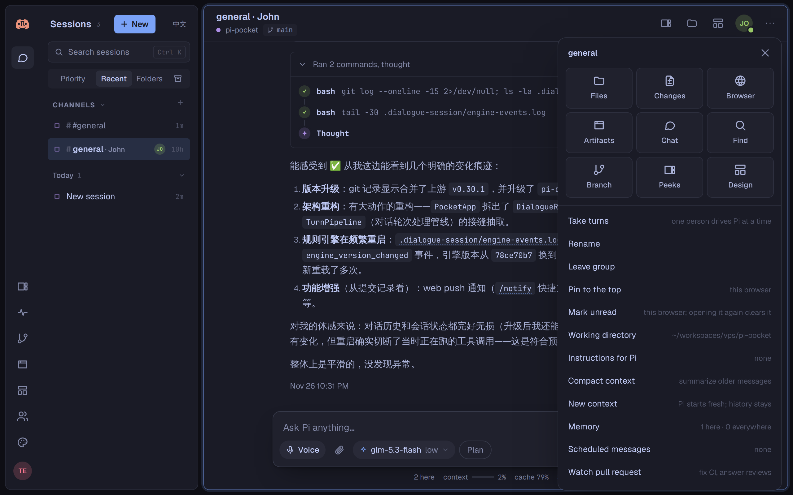

3. 点击后你会立刻退出该群组，页面自动退回首页，该群聊也会从你的侧栏列表中移除；同时创建者侧的成员列表会自动刷新去掉你的勾选。

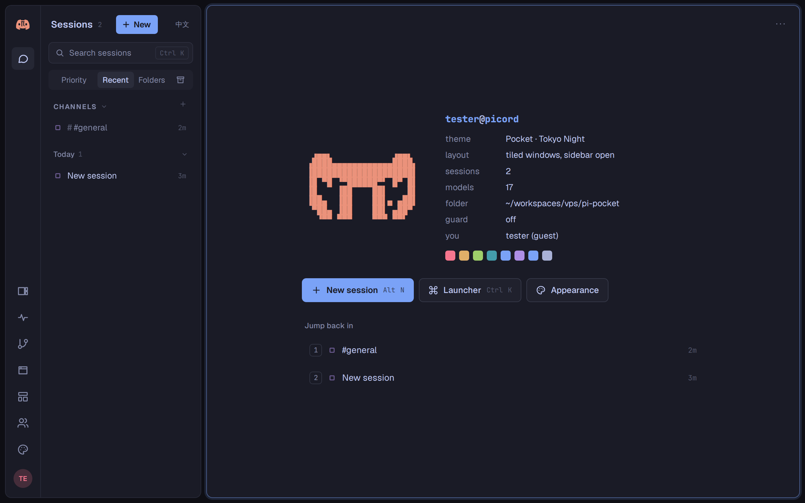

---

## 附录：中英文切换、常用快捷操作与手机端安装

### 1. 一键切换中文界面

- 点击左侧栏顶部 `+ New` 按钮右侧的 **`中文`** 按钮，可一键切换中文/英文界面标签。

### 2. 常用快捷键与斜杠命令

- `Alt + N`：新建私人对话
- `Ctrl + K`：打开全局搜索与快速跳转面板
- 在聊天输入框输入 `/` 可呼出快捷指令面板，常用的有：
  - `/channel 频道名`：创建或跳转到自己的私有 `#频道`
  - `/compact`：总结并压缩较长的上下文历史，节省费用与响应时间
  - `/new`：在当前会话目录开启一轮全新的空白上下文（历史记录仍保留可查）

### 3. 安装到手机桌面（PWA 网页应用）

Picord 已针对移动端与桌面浏览器适配为可安装的网页应用（PWA）：

- **iPhone / iPad（Safari）**：用 Safari 打开站点 → 点击底部“分享”按钮 → 选择 **添加到主屏幕**。
- **Android（Chrome / Edge）**：用浏览器打开站点 → 点击右上角菜单 → 选择 **安装应用 / 添加到主屏幕**。
- 安装后即可像独立 App 一样全屏打开使用，同样完整支持语音输入与推送通知。
