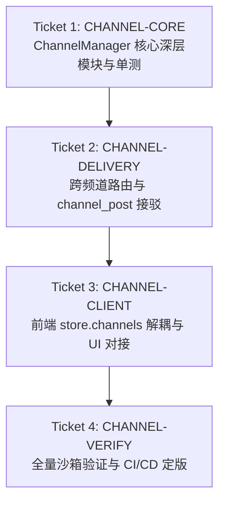

# Tickets: Deep Channel Subsystem

Derived from [specs/0001-deep-channel-subsystem.md](./0001-deep-channel-subsystem.md)

## Dependency Graph

---

### Ticket 1: [CHANNEL-CORE] ChannelManager 核心深层模块与内存适配器单测

- **Goal**: 建立独立的深层 `ChannelManager` 模块，封装频道名称规范化、唯一性检查与生命周期，并通过独立单测验证。
- **Files**:
    - `src/server/channels.ts` (新建)
    - `test/channels.test.ts` (新建)
- **Scope**:
    - 定义 `Channel` 领域接口与 `ChannelStore` 存储适配器抽象。
    - 实现名称标准化（去 `#`、转小写、正则 `^[a-z0-9_-]+$` 校验）。
    - 实现查重逻辑与列举/检索。
    - 编写内存适配器并在 `test/channels.test.ts` 验证全部命名与查重边界。
- **Blocking**: None (Ready to start)

---

### Ticket 2: [CHANNEL-DELIVERY] 跨频道安全路由与 channel_post 接驳

- **Goal**: 实现强类型的跨频道消息投递与来源追踪，将 `PocketApp` 和 `channels.ts` 工具全面委托给 `ChannelManager`。
- **Files**:
    - `src/server/channels.ts`
    - `src/server/extensions/channels.ts`
    - `src/server/app.ts`
    - `src/server/host.ts`
    - `test/channels.test.ts`
- **Scope**:
    - `ChannelManager.post` 实现目标频道严格存在性校验（不存在或已归档抛 404，绝不模糊猜词）。
    - 发件人身份追溯与 `via #source-channel` 标签注入。
    - `PocketApp` 初始化并在启动时挂载 `ChannelManager`，移除原 `app.ts` 中散落的冗余判断。
    - 扩展 `test/channels.test.ts` 测试跨频道投递成功与报错路径。
- **Blocking**: Ticket 1

---

### Ticket 3: [CHANNEL-CLIENT] 前端 store.channels 解耦与 UI 对接

- **Goal**: 前端消费层解耦，视图组件直接消费标准频道列表，抹平底层会话细节。
- **Files**:
    - `web/store.js`
    - `web/composer.js`
    - `web/sessions.js`
    - `web/commands.js`
- **Scope**:
    - 在 `web/store.js` 中维护并暴露统一的 `store.channels` 派生集合。
    - 输入框 `composer.js` 敲 `#` 联想从 `store.channels` 消费。
    - 侧边栏 `sessions.js` 统一从 `store.channels` 消费，删除各处零散的手写 `s.channel === true`。
- **Blocking**: Ticket 2

---

### Ticket 4: [CHANNEL-VERIFY] 全量沙箱验证与 CI/CD 监控定版

- **Goal**: 全流程端到端校验，云端沙箱隔离跑测，生产服务热启，GitHub Actions CI/CD 监控。
- **Scope**:
    - 本地与 InstaBox 跑通 `npm run check && npm run lint`。
    - 本地 `systemctl --user restart pi-pocket.service` 冒烟。
    - 提交推送并使用 `gh run watch` 监控 CI/Pages 达到全绿。
    - 更新项目档案 [PI-POCKET.md](../../../T3code/commmander/PI-POCKET.md)。
- **Blocking**: Ticket 3
