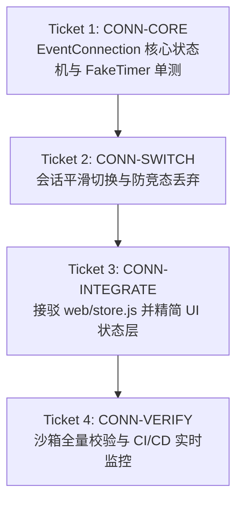

# Tickets: Deep Event Connection Engine

Derived from [specs/0002-event-connection-engine.md](./0002-event-connection-engine.md)

## Dependency Graph

---

### Ticket 1: [CONN-CORE] EventConnection 核心状态机与 FakeTimer 单测

- **Goal**: 建立独立的深层 `EventConnection` 连接引擎，支持依赖注入与时间操控，通过单测完整覆盖心跳、休眠唤醒探测与看门狗。
- **Files**:
    - `web/connection.js` (新建)
    - `test/connection.test.ts` (新建)
- **Scope**:
    - 实现 `EventConnection` 类，接收环境依赖 `{ now, setTimeout, clearTimeout, setInterval, clearInterval, EventSource, fetch, storage }`。
    - 实现 SSE 传输流生命周期、心跳时间戳测量（`ping` 事件解析）。
    - 实现 ADR-0001 规则：`isSilent(missed)`、`.wake()` 前台唤醒探测（>1.5× 触发重连）、看门狗定时器（>2.5× 触发重连）。
    - 实现失败退避重试（Backoff）。
    - 在 `test/connection.test.ts` 中用轻量 FakeTimers + Mock EventSource 跑通核心生命周期单测（运行耗时 < 10ms）。
- **Blocking**: None (Ready to start)

---

### Ticket 2: [CONN-SWITCH] 会话平滑切换与防竞态丢弃

- **Goal**: 在连接引擎内部原生承接在存连接上的会话切换协议，杜绝时序竞态。
- **Files**:
    - `web/connection.js`
    - `test/connection.test.ts`
- **Scope**:
    - 实现 `switchSession(conversationId, have)` 与单调递增的 `switchSeq`。
    - 会话切换过程中自动屏蔽属于老会话的事件（`view`, `chat`, `notes`, `presence`, `browser`, `missing`）。
    - 遇到切换失败或网络中断时自动重连。
    - 扩展 `test/connection.test.ts` 验证会话切换与延迟事件拦截。
- **Blocking**: Ticket 1

---

### Ticket 3: [CONN-INTEGRATE] 接驳 web/store.js 并精简 UI 状态层

- **Goal**: 重构 `web/store.js`，剥离 350+ 行网络与定时器细节，转为纯净消费 `EventConnection`。
- **Files**:
    - `web/store.js`
- **Scope**:
    - 在 `web/store.js` 中实例化 `EventConnection`。
    - 绑定 `onEvent`（路由到各事件处理函数）、`onStatusChange`（更新 `store.state.connection`）以及 `onAuthRequired`（唤起登录）。
    - 将 `document.addEventListener("visibilitychange")` 的唤醒逻辑简化为一行 `connection.wake()`。
    - 移除原 `store.js` 中冗余的手写 `streamEvents`、`watchdog`、`silent` 辅助函数。
- **Blocking**: Ticket 2

---

### Ticket 4: [CONN-VERIFY] 全量沙箱跑测与 CI/CD 实时监控

- **Goal**: 端到端全量质量验证，沙箱隔离编译，生产服务热启，更新项目档案。
- **Scope**:
    - 执行 `npm run format`、`npm run check` 与 `node --test test/connection.test.ts`。
    - 执行 `npm run check:sandbox`（InstaBox 沙箱跑测）。
    - 本地重启 `systemctl --user restart pi-pocket.service` 冒烟验证。
    - 提交推送并使用 `gh run watch -R Feng-H/picord` 实时跟踪 CI/Pages 全绿。
    - 更新项目档案 [PI-POCKET.md](../../../T3code/commmander/PI-POCKET.md)。
- **Blocking**: Ticket 3
