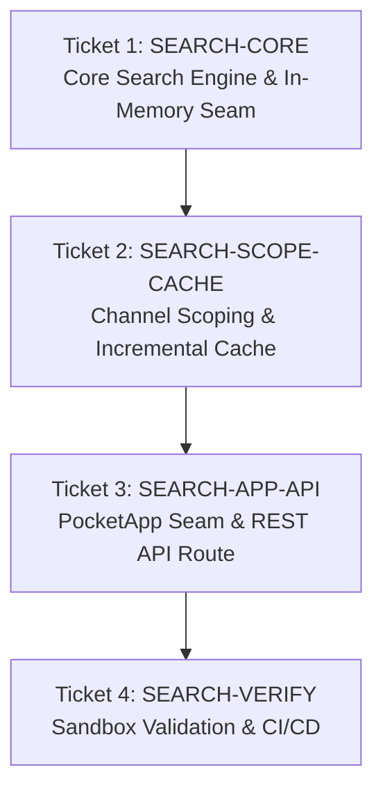

# Tickets: Decoupled History Search Engine & Channel-First Multi-Scope Retrieval

- **Spec**: [specs/0003-history-search-engine.md](./0003-history-search-engine.md)
- **ADR Reference**: [docs/adr/0004-history-search-engine.md](../docs/adr/0004-history-search-engine.md)

---

### Ticket 1: SEARCH-CORE — Core Search Engine & In-Memory Test Seam

- **Goal**: Create `src/server/history-search.ts` with `HistorySearchEngine` and `HistoryDataSource` abstraction, plus red unit tests in `test/history-search.test.ts`.
- **Files**:
    - `src/server/history-search.ts`
    - `test/history-search.test.ts`
- **Acceptance Criteria**:
    - `HistoryDataSource` interface defines `getSessions()`, `getSessionMeta(id)`, and `readEntries(id, minEntryId, limit)`.
    - `HistorySearchEngine` extracts entry words from model contents (handling strings, text blocks, toolCalls, and stripping `CONTEXT_BLOCK`).
    - Search matches text case-insensitively and returns structured match records with excerpts (context before and after match).
    - Empty query throws `HttpError(400)`.
    - Limit is clamped to `[1, 25]`, default `10`.
    - Pure in-memory unit tests in `test/history-search.test.ts` pass in <20ms.

---

### Ticket 2: SEARCH-SCOPE-CACHE — Channel-First Scoping & Incremental Immutability Cache

- **Goal**: Implement multi-scope resolution (`"current"`, `"all"`, `"#<channel>"`, `"channels"`, `"chats"`) and incremental caching based on `lastIndexedEntryId`.
- **Files**:
    - `src/server/history-search.ts`
    - `test/history-search.test.ts`
- **Acceptance Criteria**:
    - Scope `"#general"` searches only the session where `session.channel === true` and name matches `general`.
    - Scope `"channels"` searches across all sessions where `session.channel === true`.
    - Scope `"chats"` searches across all sessions where `session.channel !== true`.
    - Scope `"all"` searches all active sessions.
    - Scope `"current"` or empty searches the active conversation.
    - Scope `<numericId>` searches the specified conversation ID.
    - Incremental cache: once a session's entries up to ID $K$ are read, subsequent searches only fetch `minEntryId > K`.
    - Unit tests verify scope isolation and incremental cache behavior.

---

### Ticket 3: SEARCH-APP-API — PocketApp Integration & REST API Route

- **Goal**: Wire `HistorySearchEngine` into `src/server/app.ts`, expose `GET /api/search`, and keep `host.history.search` 100% backward-compatible.
- **Files**:
    - `src/server/app.ts`
    - `src/server/host.ts`
    - `src/server/http/conversation-routes.ts` (or `src/server/app.ts` HTTP router)
- **Acceptance Criteria**:
    - `PocketApp` instantiates `HistorySearchEngine` with a data source adapter wrapping `this.sessions()`, `this.sessionMeta()`, and `this.conversation(id).entries(...)`.
    - `host.history.search` delegates to the search engine, returning formatted string results for Agent `search_history` tool.
    - New route `GET /api/search?q=<query>&scope=<scope>&limit=<limit>`:
        - Authenticates the request via `app.requireUser(request)`.
        - Filters target sessions by `app.requireSee(user, id)`.
        - Returns JSON response with structured matches and summary counts.
    - `npm run check` and `npm run lint` pass with 0 errors.

---

### Ticket 4: SEARCH-VERIFY — Sandbox Validation, Smoke Test & CI/CD

- **Goal**: Full-stack regression testing, cloud sandbox isolation check, service restart, and live monitoring.
- **Files**:
    - `/home/ubuntu/T3code/commmander/PI-POCKET.md`
- **Acceptance Criteria**:
    - Unit tests `test/history-search.test.ts`, `test/connection.test.ts`, and `test/channels.test.ts` pass 100%.
    - `npm run format && npm run lint && npm run check` pass 100%.
    - `npm run check:sandbox` (InstaBox cloud container) exits with 0.
    - User service `systemctl --user restart pi-pocket.service` restarts cleanly and returns HTTP 200 on internal and external endpoints.
    - Dedicated record `/home/ubuntu/T3code/commmander/PI-POCKET.md` updated with full audit trail (FLEET.md remains untouched).
    - Pushed to `Feng-H/picord` main branch; GitHub Actions CI and Pages workflows monitored to full green success.
