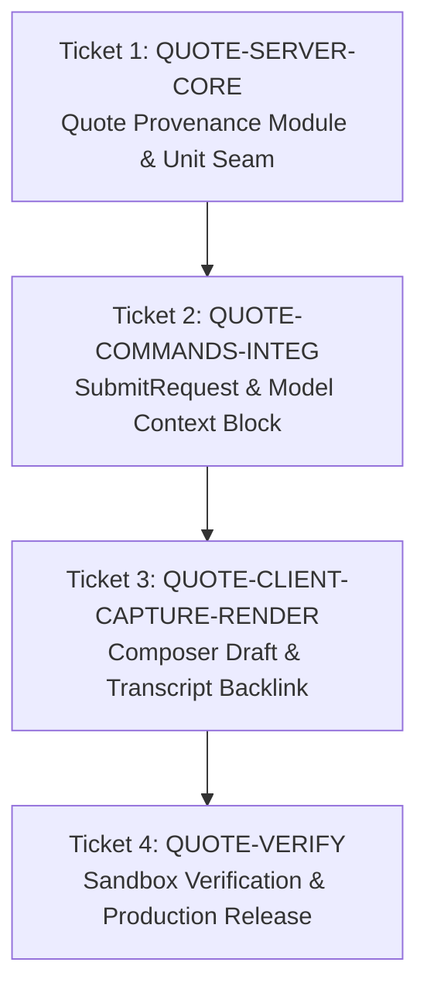

# Tickets: Cross-Scope Quote Provenance & Context Tracking

- **Spec**: [specs/0004-cross-scope-quote-provenance.md](./0004-cross-scope-quote-provenance.md)
- **ADR Reference**: [docs/adr/0005-cross-scope-quote-provenance.md](../docs/adr/0005-cross-scope-quote-provenance.md)

---

### Ticket 1: QUOTE-SERVER-CORE — Core Quote Provenance Subsystem & In-Memory Test Seam

- **Goal**: Create `src/server/quote-provenance.ts` encapsulating origin validation, IDOR security checks, and `<pocket-context quote>` block generation, verified with pure in-memory TDD unit tests.
- **Files**:
    - `src/server/quote-provenance.ts`
    - `test/quote-provenance.test.ts`
- **Acceptance Criteria**:
    - `QuoteOrigin` schema: `{ sessionId: number; entryId?: number; channel?: string; speaker?: string; text: string }`.
    - `validateQuoteOrigins(quotes, canSee, getSessionMeta)` drops unauthorized or nonexistent sessions.
    - `formatQuoteContextBlock(quotes, options)` generates structured XML conforming to `CONTEXT_BLOCK`.
    - Unit tests in `test/quote-provenance.test.ts` verify:
        1. Valid quotes generate structured origin descriptions with `session_read` guidance.
        2. Unauthorized quotes are stripped (IDOR prevention).
        3. Missing or empty quotes return `undefined`.
        4. Plain text excerpt formatting is sanitized against control characters.
    - Tests run in pure memory in <20ms.

---

### Ticket 2: QUOTE-COMMANDS-INTEG — Commands Submission & Model Prompt Wiring

- **Goal**: Update `SubmitRequest` in `src/server/commands.ts` to accept `quotes?: QuoteOrigin[]`, and wire `formatQuoteContextBlock` into model prompt generation alongside `#mentionedChannels`.
- **Files**:
    - `src/server/commands.ts`
    - `src/server/protocol.ts` (if types are exposed)
    - `test/quote-provenance.test.ts`
- **Acceptance Criteria**:
    - `SubmitRequest` accepts optional `quotes?: QuoteOrigin[]`.
    - `Commands.#aboutQuotes(id, user, quotes)` validates access using `app.canSee` and generates the context block for the model.
    - If user cannot see the source session, it degrades gracefully without throwing a 400 or leaking data.
    - The original message text written to SQLite remains standard Markdown (`> quote`).
    - Backward compatibility: hand-typed quotes or requests without `quotes` function identically to before.

---

### Ticket 3: QUOTE-CLIENT-CAPTURE-RENDER — Composer Capture & Transcript Backlinks

- **Goal**: Update `web/quote-reply.js`, `web/composer.js`, and `web/transcript.js` to preserve origin metadata on Reply, transmit it on submit, and render clickable source capsules in the transcript.
- **Files**:
    - `web/quote-reply.js`
    - `web/quote-text.js`
    - `web/composer.js`
    - `web/transcript.js`
- **Acceptance Criteria**:
    - `selected()` in `web/quote-reply.js` extracts `{ sessionId, entryId, channel, speaker }` from the enclosing `.turn` / message element.
    - `web/composer.js` retains quote metadata in composer storage and submits `quotes` in the request payload.
    - `web/transcript.js` renders a subtle origin capsule (e.g. `via #channel` or `↩ entry 42`) when a quote carries origin attribution.
    - Clicking the capsule switches to the target session/channel and scrolls to the message.

---

### Ticket 4: QUOTE-VERIFY — Sandbox Validation, Production Deploy & CI/CD

- **Goal**: Verify full test suite, execute InstaBox sandbox check, restart production systemd service, update project documentation, commit and watch GitHub Actions CI.
- **Files**:
    - `/home/ubuntu/T3code/commmander/PI-POCKET.md`
- **Acceptance Criteria**:
    - Local unit tests pass 100%.
    - `npm run check` passes with 0 type errors.
    - `npm run lint` & `npm run format` pass 100%.
    - `npm run check:sandbox` completes in InstaBox container with exit code 0.
    - `systemctl --user restart pi-pocket.service` restarts cleanly and returns HTTP 200 on `http://172.19.0.1:8790/` and `https://bot.851127.xyz/`.
    - `/home/ubuntu/T3code/commmander/PI-POCKET.md` updated with Direction C details (without touching `FLEET.md`).
    - Changes pushed to `Feng-H/picord` main, GitHub Actions CI and Pages workflows pass green.
