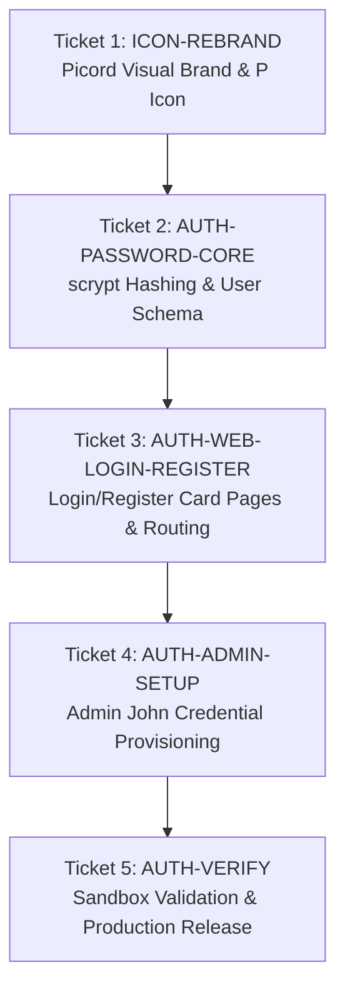

# Tickets: Password Authentication, Invite Registration & Picord Brand Identity

- **Spec**: [specs/0005-password-auth-invite-registration.md](./0005-password-auth-invite-registration.md)
- **ADR Reference**: [docs/adr/0006-password-auth-invite-registration.md](../docs/adr/0006-password-auth-invite-registration.md)

---

### Ticket 1: ICON-REBRAND — Picord Visual Brand & Geometric "P" Icon

- **Goal**: Replace the upstream mathematical `π` logo with a bespoke, futuristic "P" symbol and channel matrix lines across SVG and dynamic client-side rendering.
- **Files**:
    - `web/icon.svg`
    - `web/app-icon.js`
    - `test/app-icon.test.ts`
- **Acceptance Criteria**:
    - `web/icon.svg` renders a crisp, modern geometric "P" inside the rounded dark frame with gradient ring stroke.
    - `web/app-icon.js` renders the identical shapes with palette variables (`--o-bg`, `--o-bg-darker`, `--o-cyan`, `--o-green`, `--o-orange`).
    - `test/app-icon.test.ts` passes with the updated shapes and verifies palette colors.
    - PWA PNG icons (`web/apple-touch-icon.png`, `web/icon-192.png`, `web/icon-512.png`) are updated.

---

### Ticket 2: AUTH-PASSWORD-CORE — scrypt Password Hashing & Schema Updates

- **Goal**: Implement zero-dependency, memory-hard password hashing using Node's native `crypto.scrypt` and extend `ConfigStore` with username lookup and password storage.
- **Files**:
    - `src/server/password.ts`
    - `src/server/config.ts`
    - `test/password.test.ts`
- **Acceptance Criteria**:
    - `hashPassword(password)` produces `scrypt$<saltHex>$<derivedKeyHex>`.
    - `verifyPassword(password, hash)` returns `true` for matching passwords, `false` for incorrect passwords, and rejects malformed hashes.
    - Uses `crypto.timingSafeEqual` to prevent timing attacks.
    - `ConfigStore.userByName(name)` performs case-insensitive lookup.
    - `ConfigStore.setPassword(userId, passwordHash)` updates and persists to `config.json`.
    - Unit tests in `test/password.test.ts` pass in <50ms.

---

### Ticket 3: AUTH-WEB-LOGIN-REGISTER — Login & Register Web Flow

- **Goal**: Provide modern, card-style `/login` and `/register` web interfaces supporting username/password sign-in and invite code redemption.
- **Files**:
    - `src/server/http/sign-in.ts`
    - `src/server/http/api.ts`
    - `web/style.css` (if additional styles needed)
- **Acceptance Criteria**:
    - `GET /login` renders a dark card with username and password inputs, plus links to register or use an emergency token.
    - `POST /login` verifies username and password, sets `pocket_auth` cookie, and redirects to `/`.
    - `GET /register` renders an invite registration card (Invite code, username, password, confirm password).
    - `POST /register`:
        - Rejects missing, invalid, or expired invite codes with HTTP 400.
        - Rejects taken usernames with HTTP 400.
        - Successfully redeems invite, adds user as `role: "member"`, saves password hash, sets cookie, and redirects to `/`.

---

### Ticket 4: AUTH-ADMIN-SETUP — Admin John Credential Provisioning

- **Goal**: Generate a cryptographically secure initial password for administrator `John`, hash it with `scrypt`, and store it in `~/.pi-pocket/config.json`.
- **Files**:
    - `~/.pi-pocket/config.json`
- **Acceptance Criteria**:
    - Admin `John` in `config.json` has `passwordHash` populated with valid scrypt hash.
    - The generated plaintext password is securely shared with the user in the delivery summary.
    - Admin `John` can log in via `/login` with `John` and the new password.

---

### Ticket 5: AUTH-VERIFY — Sandbox Validation, Service Restart & CI/CD

- **Goal**: Validate full test suite, pass InstaBox sandbox check, restart systemd service, verify HTTP 200, update project documentation, commit and watch CI/CD.
- **Files**:
    - `/home/ubuntu/T3code/commmander/PI-POCKET.md`
- **Acceptance Criteria**:
    - All unit tests pass 100%.
    - `npm run check` and `npm run lint` pass with 0 errors.
    - `npm run check:sandbox` succeeds in InstaBox.
    - `systemctl --user restart pi-pocket.service` succeeds and curl returns HTTP 200.
    - `/home/ubuntu/T3code/commmander/PI-POCKET.md` updated without touching `FLEET.md`.
    - GitHub Actions CI and Pages workflows complete green.
