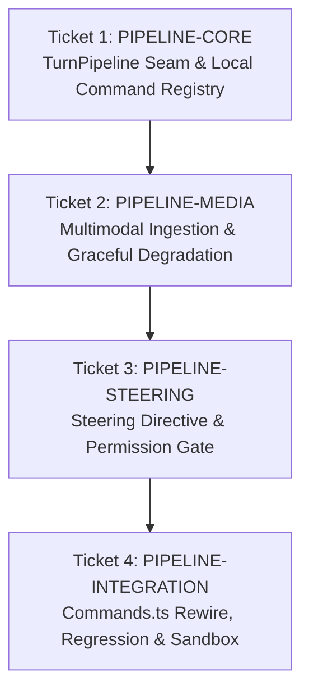

# Tickets: Deep TurnPipeline Module & Local Command Registry

- **Spec**: [specs/0006-turn-pipeline-deep-module.md](./0006-turn-pipeline-deep-module.md)
- **ADR Reference**: [docs/adr/0008-turn-pipeline-deep-module.md](../docs/adr/0008-turn-pipeline-deep-module.md)

---

### Ticket 1: PIPELINE-CORE — Core TurnPipeline Seam & Local Command Registry

- **Goal**: Implement the core `TurnPipeline` module and an extensible `LocalCommandRegistry`, moving hardcoded `/rule` command handling into the registry.
- **Files**:
    - `src/server/turn-pipeline/registry.ts`
    - `src/server/turn-pipeline/pipeline.ts`
    - `src/server/turn-pipeline/index.ts`
    - `test/turn-pipeline-core.test.ts`
- **Acceptance Criteria**:
    - `LocalCommandRegistry` matches prefix commands (`/rule`, `/help`) and extracts args.
    - Matching commands return a `NOTE_ENTRY` result without invoking LLM or durable task leases.
    - Unknown text passes through to standard turn admission.
    - Unit tests in `test/turn-pipeline-core.test.ts` pass.

---

### Ticket 2: PIPELINE-MEDIA — Multimodal Media Ingestion & Graceful Degradation

- **Goal**: Extract audio STT transcription, image normalization, quote context, and channel mentions into resilient pipeline stages with graceful degradation.
- **Files**:
    - `src/server/turn-pipeline/media.ts`
    - `src/server/turn-pipeline/pipeline.ts`
    - `test/turn-pipeline-media.test.ts`
- **Acceptance Criteria**:
    - Successfully transcribes audio and normalizes images when helpers succeed.
    - When audio STT or image helper throws an error, the pipeline catches it, preserves the user's typed text, and appends a degradation warning note.
    - Unit tests in `test/turn-pipeline-media.test.ts` verify both success and failure-fallback paths.

---

### Ticket 3: PIPELINE-STEERING — Steering Directive & Permission Gate

- **Goal**: Support `/steer` prefix and `request.mode === "steer"` directives, enforcing that only administrators (`owner`) or the active turn's author can interrupt/steer.
- **Files**:
    - `src/server/turn-pipeline/steering.ts`
    - `src/server/turn-pipeline/pipeline.ts`
    - `test/turn-pipeline-steering.test.ts`
- **Acceptance Criteria**:
    - `/steer <msg>` sets steering mode and strips the prefix.
    - If `mode === "steer"` and actor is admin or active turn author, sets `whenBusy: "steer"`.
    - If actor is an unauthorized third party, automatically demotes `whenBusy` to `"followUp"` (queue).
    - Unit tests in `test/turn-pipeline-steering.test.ts` pass.

---

### Ticket 4: PIPELINE-INTEGRATION — Commands Rewire, Full Regression & Sandbox Check

- **Goal**: Wire `TurnPipeline` into `Commands` and `PocketApp`, removing bloated helpers from `Commands.submit`, ensuring 100% test pass and InstaBox sandbox verification.
- **Files**:
    - `src/server/commands.ts`
    - `src/server/app.ts`
    - `test/` (all existing test suites)
- **Acceptance Criteria**:
    - `Commands.submit` delegates to `app.turnPipeline.submit`.
    - Legacy commands (`/rule`, audio, attachments) continue to function identically.
    - Local test suite (`npm test`) passes with 0 failures.
    - InstaBox sandbox check (`npm run check:sandbox`) passes 100%.
    - Document updates in `/home/ubuntu/T3code/commmander/PI-POCKET.md`.
